<div align="center">

# 高中物理可视化演示工具

**Visualization Tools for High School Physics**

12 个可交互的高中物理课堂演示 · 打开浏览器即可使用 · 零依赖、零构建、可离线

[在线使用](https://teio.asia) · [下载离线包](./PhysicsTeachTool.zip) · [English](#english)

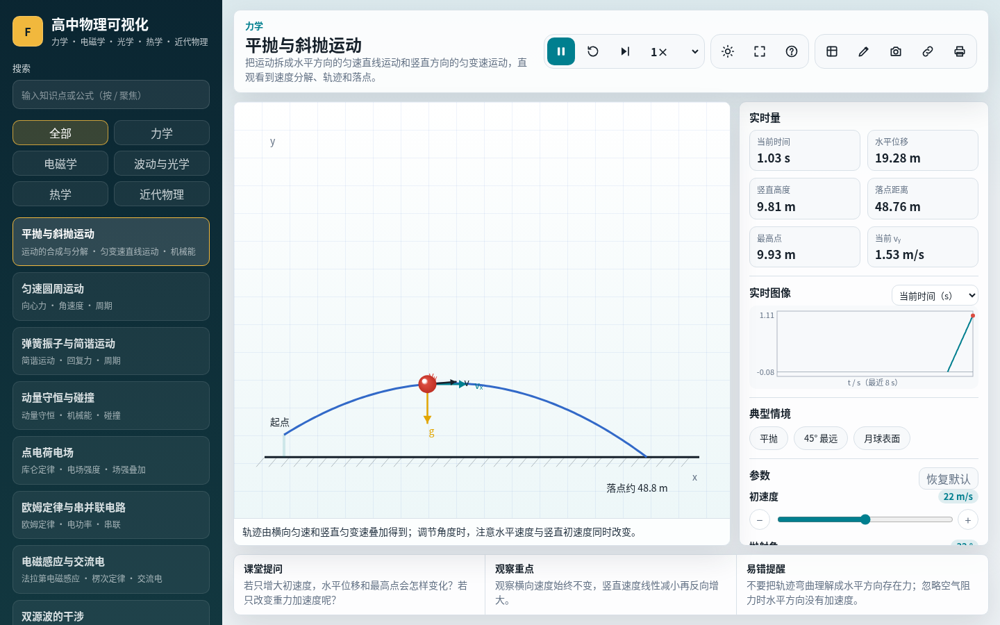

</div>

---

## ✨ 功能特点

- **12 个核心主题**，覆盖力学、电磁学、波动与光学、热学、近代物理。
- **参数实时可调**：拖动滑块，画面、实时物理量和成像性质同步更新。
- **教学设计内置**：每个主题都附带「课堂提问 / 观察重点 / 易错提醒」和核心公式。
- **课堂友好**：播放 / 暂停 / 单步 / 重置，支持键盘快捷键；高 DPI 屏幕（投影、平板）清晰显示。
- **可直接分享某个主题**：地址栏会自动带上 `#主题id`，例如 `…/index.html#lens` 直接打开凸透镜成像。
- **实时图像**：任选随时间变化的物理量，绘制随时间变化的曲线（x-t、v-t、ε-t……）。
- **数据记录 + CSV 导出**：一键把当前参数和结果记成一行，导出后可用 Excel 打开并作图，适合“实验探究”式教学。
- **画笔批注**：投影时直接在画面上圈画讲解，可撤销、清除。
- **导出图片 / 打印讲义 / 分享链接**：导出带参数说明的 PNG；生成 A4 讲义；复制带当前参数的链接（如 `#lens?object=24`）。
- **浅色 / 深色主题**：默认跟随系统，按 `T` 或点工具栏按钮切换，选择会被记住。
- **演示模式（投影）**：点 ⛶ 或按 `F` 全屏、隐藏侧栏、放大字号，适合教室投影。
- **典型情境预设**：如 u = 2f、完全弹性碰撞、水→空气全反射，一键切换。
- **播放速度**：0.25× ~ 2×，慢放观察细节。
- **手机 / 平板适配**：窄屏下侧栏变为抽屉（☰），滑块旁带 − / + 微调按钮，点击画布即可暂停。
- **新手引导**：首次打开显示使用帮助，随时按 `?` 再次查看。
- **零依赖**：纯 HTML + CSS + 原生 JavaScript，双击 `index.html` 即可运行，不需要联网和安装。

## 📚 主题一览

| 领域 | 主题 | 可调参数 | 关键物理量 |
| --- | --- | --- | --- |
| 力学 | 平抛与斜抛运动 | 初速度、抛射角、初始高度、重力加速度 | 位移、最高点、落点、vᵧ |
| 力学 | 匀速圆周运动 | 半径、线速度、质量 | ω、T、向心加速度、向心力 |
| 力学 | 弹簧振子与简谐运动 | 振幅、角频率、质量 | x、v、a、T、k、总能量 |
| 力学 | 动量守恒与碰撞 | 两车质量、初速度、恢复系数 | 碰后速度、总动量、动能损失 |
| 电磁学 | 点电荷电场 | 两电荷电量、间距、探针位置 | 探针场强及分量 |
| 电磁学 | 欧姆定律与串并联电路 | 连接方式、电压、R₁、R₂ | 等效电阻、电流、分压、功率 |
| 电磁学 | 电磁感应与交流电 | 匝数、B、面积、角速度 | Φ、瞬时/最大电动势、频率 |
| 波动与光学 | 双源波的干涉 | 波长、双源间距、相位差、振幅 | 波程差、Δr/λ |
| 波动与光学 | 凸透镜成像 | 焦距、物距、物高 | 像距、放大率、像高、成像性质 |
| 波动与光学 | 折射定律与全反射 | n₁、n₂、入射角 | 折射角、临界角、是否全反射 |
| 热学 | 理想气体状态方程 | 温度、体积、物质的量 | 压强、PV、nRT |
| 近代物理 | 光电效应 | 频率、逸出功、光强 | 光子能量、最大初动能、遏止电压、截止频率 |

<details>
<summary>📸 更多截图</summary>

| | |
| --- | --- |
| 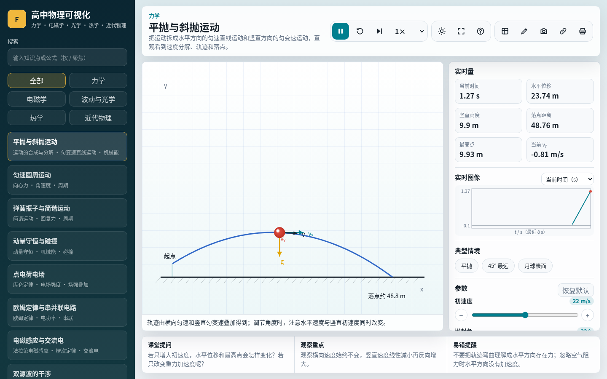 | 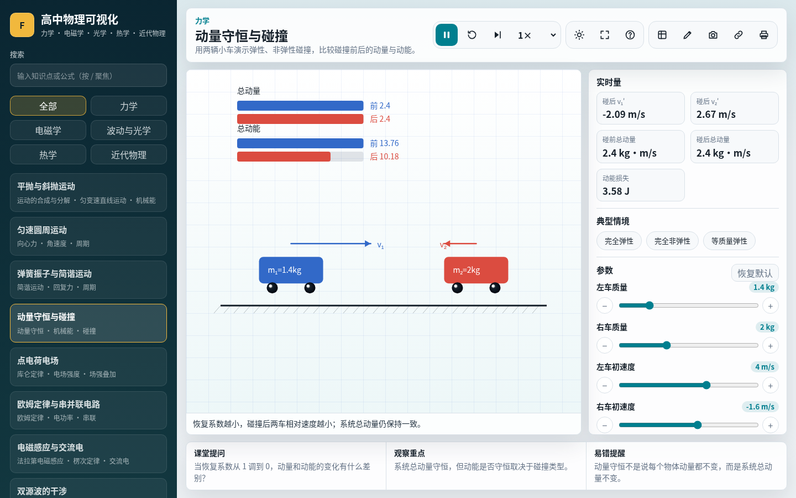 |
| 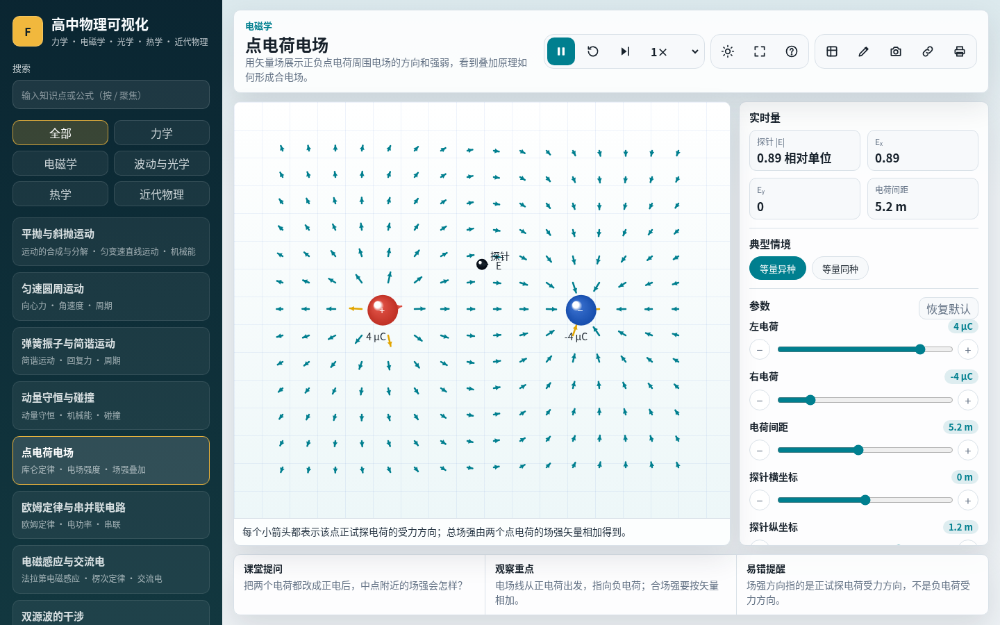 | 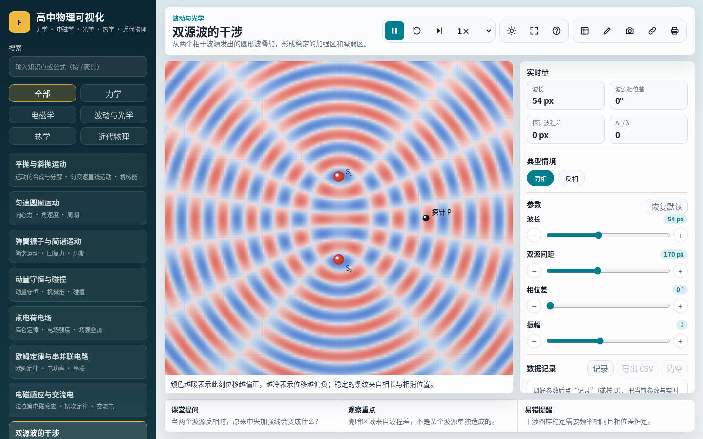 |
| 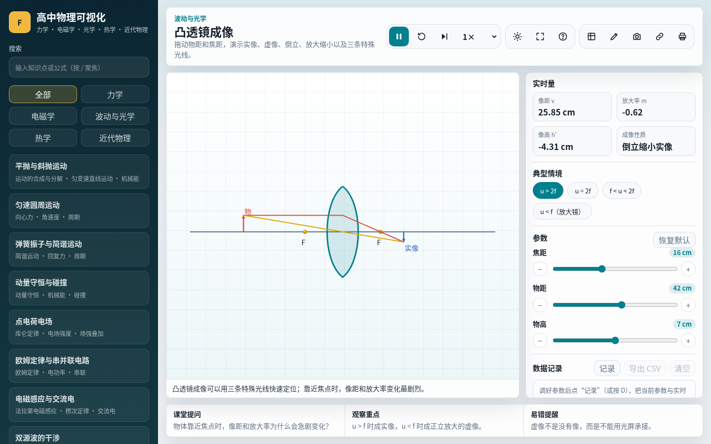 | 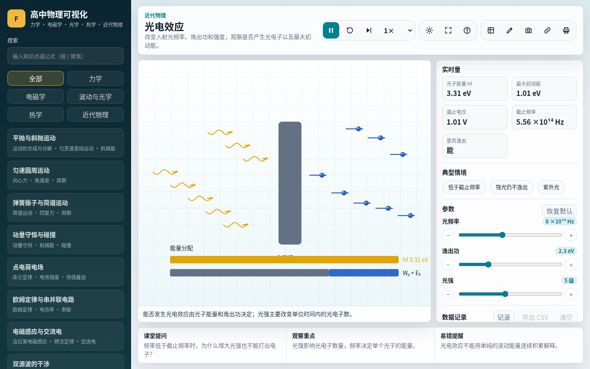 |
| 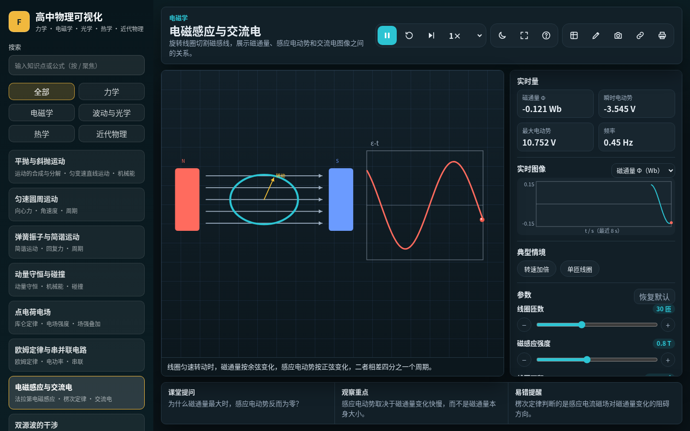 | 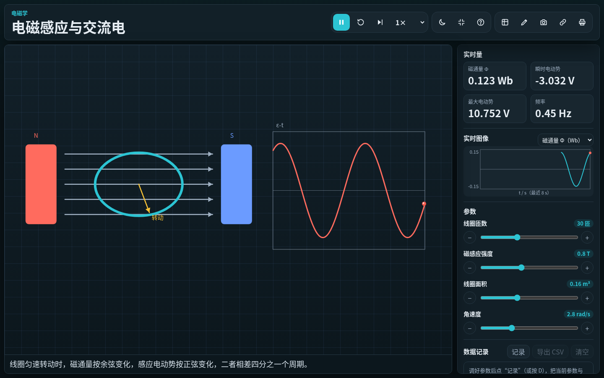 |
| 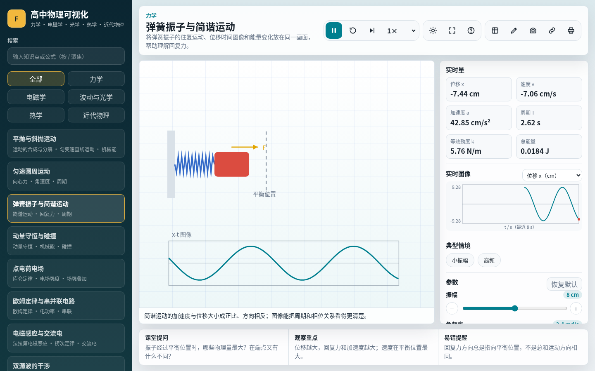 | 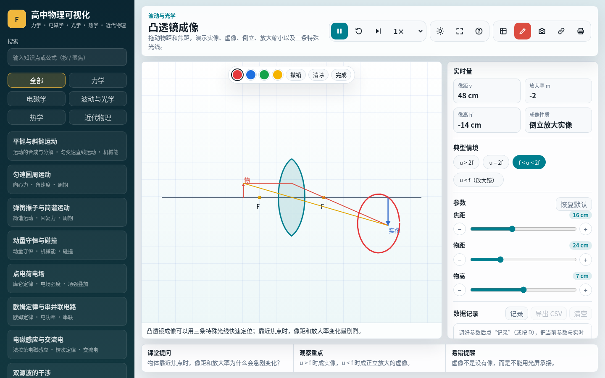 |
| 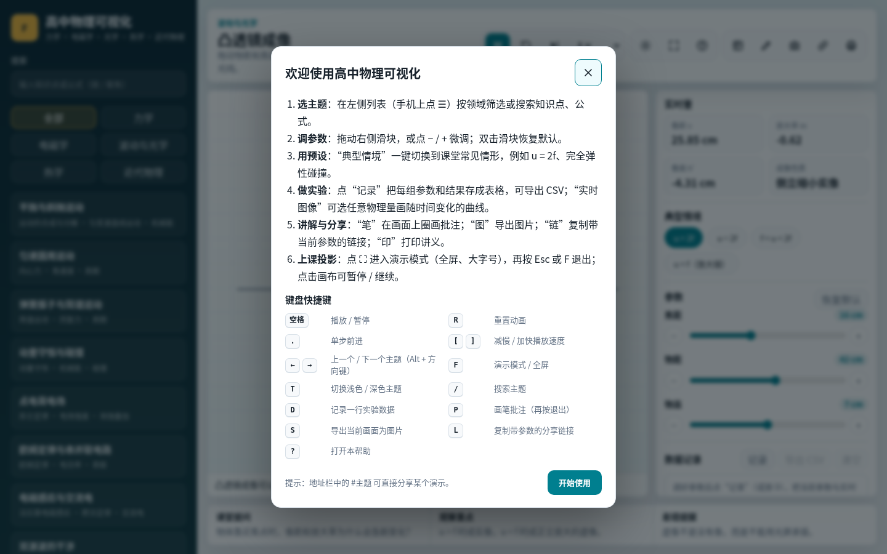 | 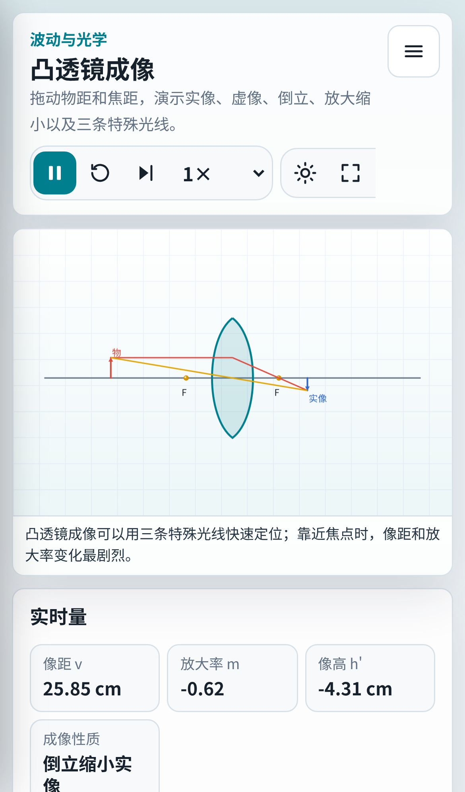 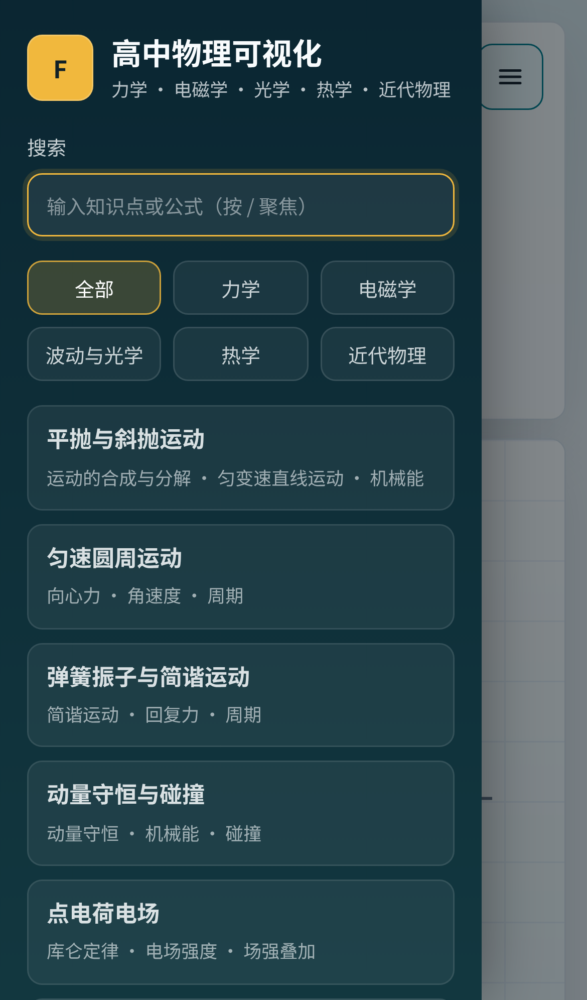 |

</details>

## 🚀 使用方法

### 方式一：在线打开（推荐）

直接访问 **<https://teio.asia>**（GitHub Pages 部署）。

### 方式二：离线使用

1. 下载 [`PhysicsTeachTool.zip`](./PhysicsTeachTool.zip) 或点击 GitHub 上的 **Code → Download ZIP**。
2. 解压整个文件夹。
3. 双击 `index.html`，用 Chrome / Edge / Firefox / Safari 打开即可。

> ⚠️ **分享给别人时**：不要只发送浏览器地址栏里的 `file:///C:/...` 链接——它指向你自己电脑上的文件，别人打不开。请发送完整压缩包，或者直接分享在线网址。

### 键盘快捷键

| 按键 | 作用 |
| --- | --- |
| `空格` | 播放 / 暂停 |
| `R` | 重置动画时间 |
| `.` 或 `Shift + →` | 单步前进（自动暂停） |
| `[` / `]` | 减慢 / 加快播放速度 |
| `Alt + ←` / `Alt + →` | 上一个 / 下一个主题 |
| `F` | 演示模式 / 全屏（`Esc` 退出） |
| `T` | 切换主题：跟随系统 → 浅色 → 深色 |
| `D` | 记录一行实验数据 |
| `P` | 画笔批注（`Z` 撤销、`Esc` 退出） |
| `S` | 导出当前画面为 PNG |
| `L` | 复制带当前参数的分享链接 |
| `?` | 打开使用帮助 |
| `/` | 聚焦搜索框 |
| 搜索框中 `Enter` / `Esc` | 打开第一个结果 / 清空搜索 |
| 双击滑块 | 将该参数恢复默认值 |
| 点击画布 | 播放 / 暂停（触屏友好） |

## 🗂️ 项目结构

```text
.
├── index.html          # 页面入口
├── styles.css          # 页面样式
├── js/
│   ├── utils.js        # 数学与格式化工具
│   ├── physics.js      # 纯物理计算模型（无 DOM，可单元测试）
│   ├── classroom.js    # 分享链接编解码、CSV 生成等纯函数
│   ├── topics.js       # 主题数据：参数、公式、教学提示
│   ├── draw.js         # Canvas 绘图基元与调色板
│   ├── renderers.js    # 各主题的画面渲染器
│   └── app.js          # 状态管理、界面渲染、事件与动画循环
├── tests/              # node:test 单元测试与渲染冒烟测试
├── scripts/            # 轻量检查与打包脚本
├── docs/screenshots/   # README 截图
├── PhysicsTeachTool.zip# 离线分发包
└── CNAME               # GitHub Pages 自定义域名
```

脚本以普通 `<script>` 按顺序加载并共享全局命名空间 `PhysicsViz`。之所以不使用 ES Module，是为了保证**双击 `index.html`（`file://` 协议）也能直接运行**。

## 🛠️ 开发

无需安装依赖，只需要 [Node.js](https://nodejs.org/) ≥ 18 来运行检查和测试：

```bash
npm run check       # 语法检查 + 单元测试
npm test            # 仅运行测试
npm start           # 启动本地静态服务器 http://localhost:8080（可选）
npm run build:zip   # 重新生成离线包 dist/PhysicsTeachTool.zip
```

### 新增一个主题

1. 在 `js/physics.js` 中添加纯计算函数（可选，但便于测试）。
2. 在 `js/topics.js` 的 `topics` 数组中追加主题：`id`、`domain`、`title`、`summary`、`tags`、`renderer`、`controls`、`formulas`、`teaching`。
3. （可选）在 `js/topics.js` 末尾的 `presets` 中为该主题添加“典型情境”，测试会校验参数名、范围和步长。
4. 在 `js/renderers.js` 中实现同名渲染器 `(ctx, { w, h }, values, time) => ({ caption, metrics })`；如果画面与时间无关，把它加入 `staticRenderers` 以节省性能。
   绘图颜色请使用 `PV.COLORS`（例如 `C.ink`），这样深色主题会自动生效。
5. 运行 `npm run check`——测试会自动在每个参数的最小 / 最大值下运行新渲染器，检查是否出现 `NaN`。

更多细节见 [CONTRIBUTING.md](./CONTRIBUTING.md)，版本变化见 [CHANGELOG.md](./CHANGELOG.md)。

---

<a id="english"></a>

## English

**Visualization Tools for High School Physics** is a set of 12 interactive, classroom-ready physics demos covering mechanics, electromagnetism, waves & optics, thermodynamics and modern physics. It is pure HTML/CSS/vanilla JS with no dependencies and no build step.

- **Use online:** <https://teio.asia>
- **Use offline:** download the repo / `PhysicsTeachTool.zip`, unzip, double-click `index.html`.
- **Deep links:** append `#<topic-id>` (e.g. `#lens`, `#photoelectric`) to open a specific demo.
- **Classroom tools:** live graph of any time-varying quantity, data recording with Excel-friendly CSV export, pen annotations, PNG snapshot, A4 handout printing, and shareable links that encode the current parameters (e.g. `#lens?object=24`).
- **Shortcuts:** `D` record · `P` pen · `S` snapshot · `L` copy link · `Space` play/pause · `R` reset · `.` step · `[`/`]` speed · `Alt+←/→` prev/next topic · `F` presentation mode · `T` theme · `?` help · `/` search · double-click a slider to reset it.
- **Classroom features:** light/dark theme (follows the OS), fullscreen presentation mode for projectors, one-click presets for typical scenarios, playback speed 0.25×–2×, mobile drawer navigation with touch-friendly steppers, first-run help.
- **Develop:** `npm run check` runs syntax checks and the `node:test` suite (physics unit tests + renderer smoke tests across parameter extremes). See [CONTRIBUTING.md](./CONTRIBUTING.md).
